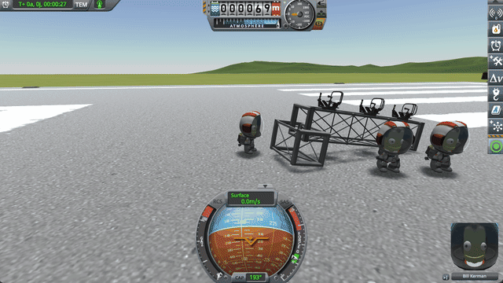
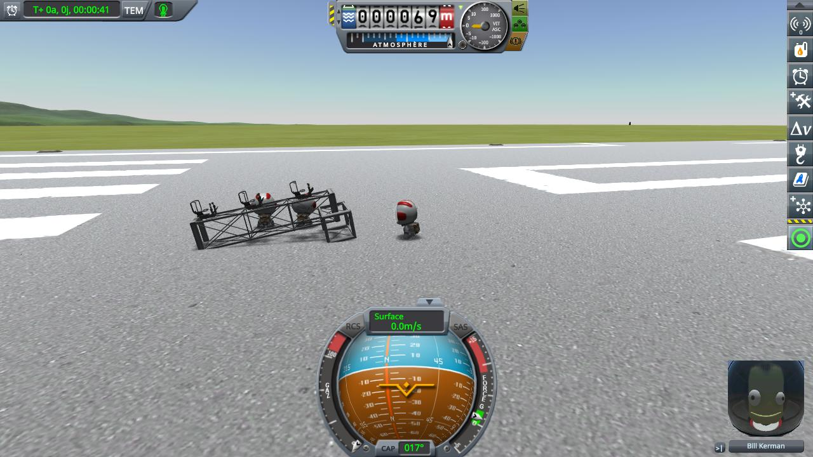
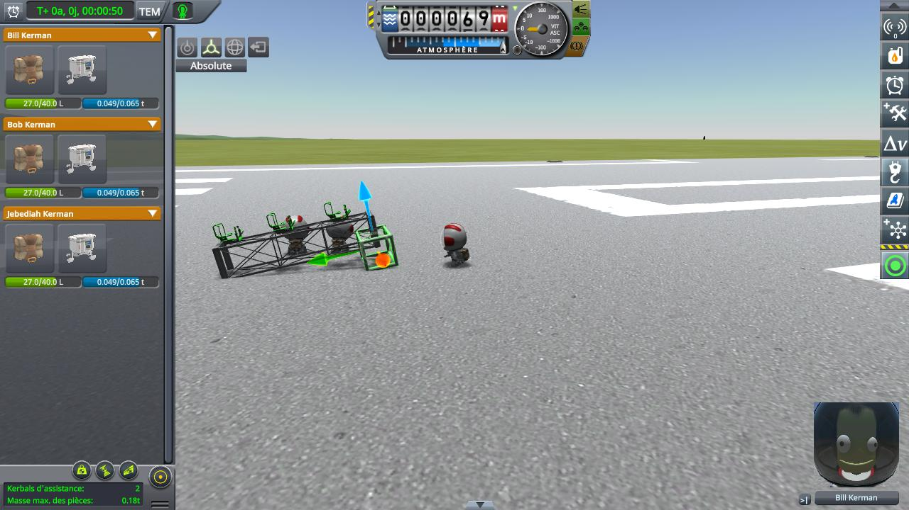
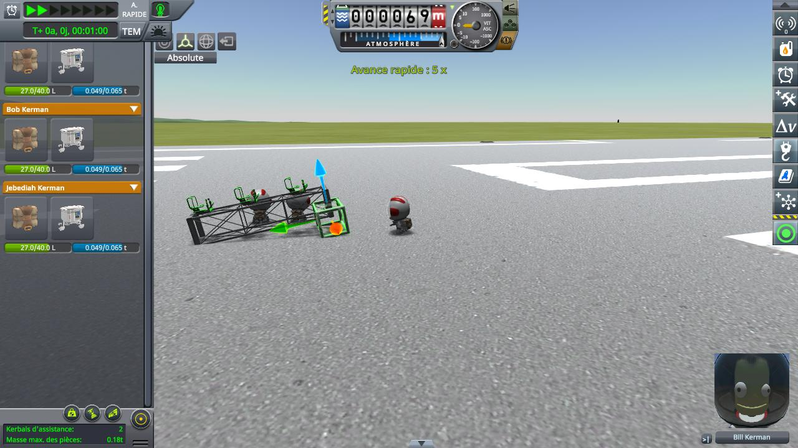
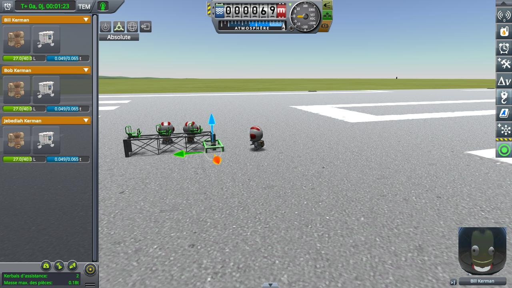
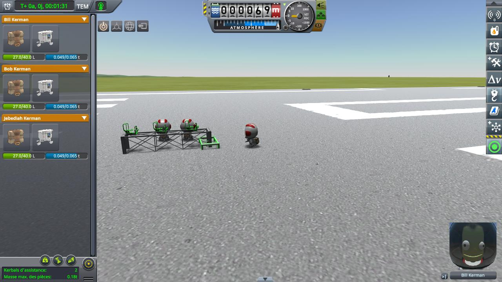
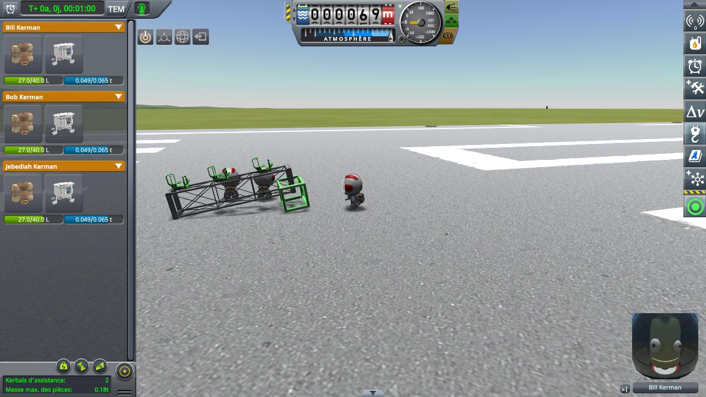

# Construction Selection Sag Fix

**⚠️ Not finished yet.** This is a new fix, not a finished mod. The code and the conclusions on this page can still change.

A fix for stock KSP 1.12, kept as small as possible: one add-on, in one source file, with no patch to the game's code.
It is a mod of its own, built on top of [KSP Community Fixes](https://github.com/KSPModdingLibs/KSPCommunityFixes),
the base most players run. Here is what it fixes:

> **In EVA construction mode, a vessel sags onto the part selected with the Move or Rotate tool.** If that part bears
> weight, a leg or a wheel, the vessel leans or tips over onto it as soon as anything jolts it: a time warp, the
> vessel settling after a load. The part ends up in the ground, and stays there once released, even after a reload.



*Stock KSP 1.12 with KSP Community Fixes. A girder frame stands on the runway; Bill, on EVA, selects the girder at
its near end with the Move tool, then warps time.*

**How this was made.** The investigation and the code were written with Claude, Anthropic's AI
assistant. Everything here was reviewed and validated by a human — me. I am saying so up front, because
contributions made with an AI deserve a closer look than others, and because some people would rather
stop reading here. That look should be quick: the stock code involved is named and quoted on this page, and the fix
is one source file you can read in a few minutes.

## Why it matters

Adjusting a leg, a wheel or a support of a landed base is what the Move and Rotate tools are for. Selecting the part
is enough to take its support away: nothing shows it, the vessel looks still. Then a warp to wait for daylight, or a
base that was still settling after the game loaded, and it drops onto the selected part. Releasing the part does not
lift it back: the vessel stays leaning, the part half in the ground, and a save keeps it that way.

## The culprit

`EVAConstructionModeEditor` turns the colliders of the selected part into triggers, so that the part does not push
anything while its gizmo moves it. It does it as soon as the part is selected, not only while the gizmo is dragged:

```csharp
// EVAConstructionModeEditor.ToggleRotateGizmo (KSP 1.12), the same in ToggleOffsetGizmo for the Move tool
gizmoRotate = GizmoRotate.Attach(selectedPart.transform, ...);
...
FetchColliders();
ToggleCollidersTrigger(toggle: true);
```

A trigger collides with nothing: the selected part no longer bears any weight. A part that has physics of its own is
made physicsless at the same time (`Part.DemoteToPhysicslessPart`), its colliders then belong to its parent's
`Rigidbody`. The vessel stands on its other supports while nothing moves it, then sits down onto the selected part.
The colliders become solid again when the part is released, but by then the part is in the ground, and the vessel
rests on it as it is.

## Checking the culprit

KSP 1.12.5 with [KSP Community Fixes](https://github.com/KSPModdingLibs/KSPCommunityFixes) 1.41.1. Copy
[selection-sag.sfs](diag/selection-sag.sfs) into the folder of a sandbox game and load it: Bill, an engineer, is on
EVA on the runway, with Bob and Jebediah, next to a frame of girders. A Modular Girder Segment XL lies on the ground
with three EAS-1 seats on top; at its near end, a short Modular Girder Segment holds that end up off the ground.



*The save loaded.*

Then, by hand:

1. Open the construction mode, and pick the Move tool.
2. Click the short girder at the near end: its gizmo shows. Do not touch the gizmo.
3. Keep it selected, and warp time at 5x for a few seconds.
4. Back to normal time.
5. Pick the Place tool to release the girder.



*Step 2: the short girder is selected. The frame has not moved yet.*



*Step 3: time warps at 5x, the girder still selected.*



*Step 4, on stock: back to normal time, a few seconds later.*



*Step 5, on stock: the girder released.*



*Step 5, with this mod: the girder released.*

- **On stock:** back to normal time, the frame has dropped onto the selected girder: it lies flat, and the girder is
  sunk into the runway. Releasing the girder does not lift the frame again.
- **With this mod:** the frame stays raised on the short girder, before and after the girder is released.

## The fix

One add-on, with its switch in [Settings](#settings), on by default. Nothing is saved; removing the mod gives the
stock behaviour back at once.

- **`holdVesselStill`.** While a part of a landed vessel is selected with the Move or Rotate tool, every `Rigidbody`
  of that vessel is frozen in place (`RigidbodyConstraints.FreezeAll`). The vessel keeps its physics, its joints and
  its flex: it only cannot move. It is let go once the selection ends, after the stock code has made the part solid
  again, or when a part of another vessel is selected. Selecting another part of the same vessel keeps it held.
- **On rails.** A vessel held that way may have no ground contact left: the selected part was its only support, or
  the player lifted all its wheels off the ground. The stock code then sees it as flying, and a flying vessel put on
  rails by a time warp follows its orbit, down through the terrain, where `Vessel.CheckKill` destroys it ("crashed
  through terrain"). When the held vessel goes on rails, the mod marks it as landed, as it is held in place. It is
  still held when the warp ends.

A vessel in flight is never held: frozen, it would stop following its orbit while the kerbal goes on.

**Why not keep the selected part solid instead.** The stock code turns it into a trigger on purpose: a solid part
moved or rotated into the ground or into its own vessel would push it, or throw it in the air.

**Why not let go of the vessel during a time warp.** On rails, the stock code already keeps a landed vessel in place.
Letting it go and holding it again when the warp ends leaves one physics step in between, where it starts to sag.

## Work in progress

What a player would see if this mod broke something, or what it should fix but was not checked yet, and how to try
it by hand, with the mod and without:

- **A heavy, flexible base.** Select a part of a base of a few hundred parts, then release it. With the mod, nothing
  should jump or shake when it is let go, and the frame rate should not drop while it is held.
- **On the Mun or Minmus.** The same as [Checking the culprit](#checking-the-culprit) under low gravity.
- **A part dragged into the ground.** Without [Construction Ground Fix](https://github.com/lhervier/KSP-Fix-ConstructionGround),
  a part dragged into the ground while the vessel is held turns solid there when released: the vessel may jump when
  it is let go. With it, the part stops at the ground.
- **All wheels lifted, then a save during the warp.** The vessel is saved as landed while it hangs in the air; after
  a reload, it should settle on the ground.
- **Switching from Rotate to Move with a part selected, or closing the panel with a part selected**: the vessel
  should be let go only once the part is solid again.

## Install

Copy the `GameData\KSPFixConstructionSelectionSag` folder into the `GameData` folder of KSP. It needs no other mod.

## Settings

`GameData\KSPFixConstructionSelectionSag\PluginData\settings.cfg` is read once, when KSP starts:

```
// Holds a landed vessel still while one of its parts is selected with the Move or Rotate tool.
holdVesselStill = True

// How much the mod writes to KSP.log: Error, Warning, Info or Debug.
logLevel = Info
```

- With `holdVesselStill = False`, the mod does nothing: the vessel sags as on stock.
- At `Debug`, the mod writes one line each time a vessel is held or let go, and one when a held vessel goes on rails
  with no ground contact.

## Build

Set `KSPDIR` to the folder of a KSP install, then run `build.bat`: it compiles
`GameData\KSPFixConstructionSelectionSag\KSPFixConstructionSelectionSag.dll`. Installing is up to you.

## License

[MIT](LICENSE).
